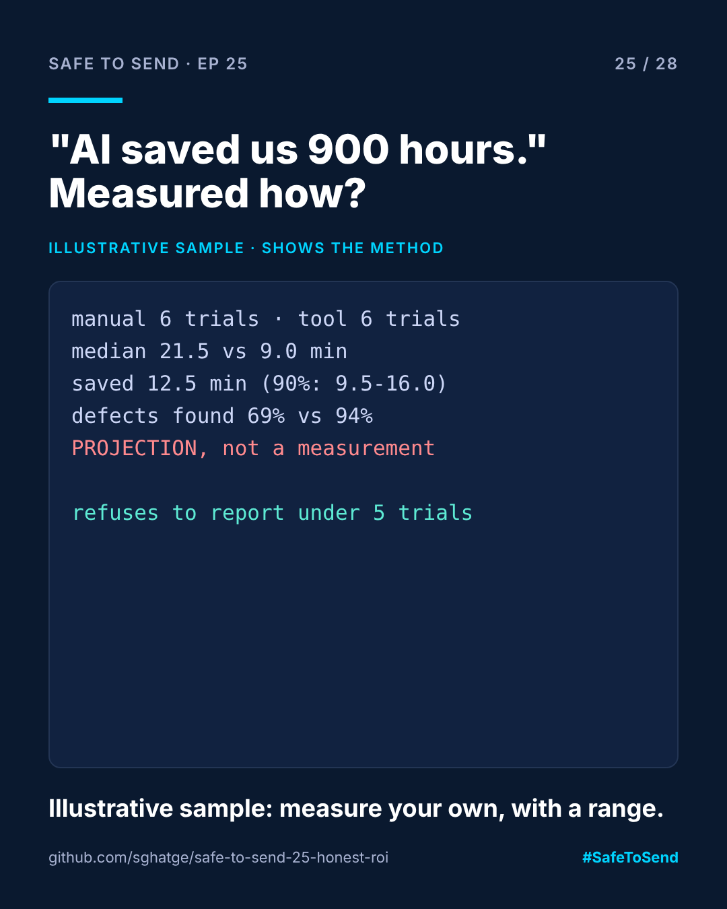

# safe-to-send-25 · Honest ROI



**Safe to Send · Episode 25** — a 28-day learn-in-public series on governing AI in CRM operations.

> "AI saved us 900 hours." Measured how?

## The real-world scenario

Every AI post claims hours saved. Almost none says how. Usually it's one person's estimate, multiplied by a campaign count, multiplied by 52, and presented as a fact. When a CFO asks how it was measured, the number collapses, and so does trust in the next claim.

## The method this tool enforces

| Rule | Why |
|---|---|
| At least 5 timed trials per method, or no report | One demo isn't data |
| Medians, not means | One bad day shouldn't decide the answer |
| A 90% interval on the saving (bootstrap) | Show the uncertainty, not just the headline |
| Defects found next to time saved | Faster but worse is not a saving |
| Annual figures only on request, labelled PROJECTION | Projections aren't measurements |
| A printed list of what was not measured | Setup, false alarms, upkeep, trust |

## Run it

```bash
python honest_roi.py examples/illustrative_trials.csv 400
```

```
Trials: manual 6, tool 6
Median minutes per campaign: manual 21.5, tool 9.0
Saved per campaign: 12.5 min (90% interval 9.5 to 16.0)
Planted defects found: manual 69%, tool 94%
PROJECTION, not a measurement: at 400 campaigns/year, 63 to 107 hours

Not measured: setup time, false alarms, maintenance, or whether people trust the tool.
```

The example file is an **illustrative sample with invented numbers**, there to show the method. To measure your own saving: copy `trials_template.csv`, time yourself checking planted-defect campaigns (see [safe-to-send-10](https://github.com/sghatge/safe-to-send-10-synthetic-market)) both ways, and run it on your file.

MIT · [Sangram Ghatge](https://www.linkedin.com/in/sangram-g-2369705b) · #SafeToSend
